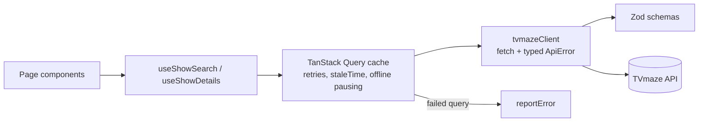

# TV Series Search

A responsive web app for searching TV series and viewing their details, built with React and TypeScript on top of the public [TVmaze API](https://www.tvmaze.com/api).

- **Search view** (`/`): type a show name and get a grid of results with poster, year, genres and rating.
- **Details view** (`/shows/:id`): poster, rating, genres, summary, key facts, seasons and cast. Every details page has its own URL, so a link can be shared and opened directly.

## Getting started

**Prerequisites:** [Node.js](https://nodejs.org/) 24 (the version CI uses) and npm.

```bash
npm ci
npm run dev
```

Then open http://localhost:5173. No API key or `.env` file is needed.

To check a production build locally:

```bash
npm run build
npm run preview   # serves dist/ on http://localhost:4173
```

### Scripts

| Script              | What it does                                                 |
| ------------------- | ------------------------------------------------------------ |
| `npm run dev`       | Starts the Vite dev server with hot reload                   |
| `npm run build`     | Typechecks and builds for production into `dist/`            |
| `npm run preview`   | Serves the production build                                  |
| `npm test`          | Runs the tests in watch mode                                 |
| `npm run test:run`  | Runs the tests once                                          |
| `npm run coverage`  | Runs the tests with a coverage report in `coverage/`         |
| `npm run lint`      | Runs ESLint (type-aware rules)                               |
| `npm run typecheck` | Runs the TypeScript compiler without emitting                |
| `npm run format`    | Formats everything with Prettier                             |
| `npm run verify`    | Runs format check, lint, typecheck, tests and build, like CI |

## Features

- **Two views with their own URLs**: `/` for search and results, `/shows/:id` for details, and a `*` route for unknown URLs.
- **Deep links**: the details page fetches its own data from the id in the URL, so it works without visiting search first. Invalid ids and unknown shows get a "Show not found" page.
- **Responsive, mobile first**: results switch from compact rows on phones to an auto-filling poster grid. The details page goes from one column to a hero plus a two-column layout.
- **Clear error feedback**: user-friendly messages with a **Retry** button, and route error boundaries for render crashes.
- **Slow and offline feedback**: a "This is taking longer than usual…" notice after 3 seconds, an offline banner, and a "waiting for your connection" message when a request is paused offline.
- **Light and dark themes** that follow the system setting.
- **Browser support**: built for current Chrome, using modern CSS (`color-mix`, `dvh`, `aspect-ratio`).

## Tech stack

| Concern         | Choice                                   | Why                                                                                                                                        |
| --------------- | ---------------------------------------- | ------------------------------------------------------------------------------------------------------------------------------------------ |
| UI              | React 19 + TypeScript (strict)           | Types shared from the API schemas through to the components. React 19 renders `<title>` natively, which gives each view its own page title |
| Build           | Vite                                     | Fast dev server and builds, and Vitest shares its config                                                                                   |
| Routing         | React Router (data router)               | URL-driven views, deep links, and `errorElement` for layered error boundaries                                                              |
| Server state    | TanStack Query                           | Caching, retries, request cancellation, offline pausing and loading/error states, without hand-written effects                             |
| HTTP            | Native `fetch`                           | Two GET endpoints don't justify Axios                                                                                                      |
| Validation      | Zod                                      | Checks API responses at runtime and gives TypeScript types from the same schema                                                            |
| Styling         | Tailwind CSS v4                          | Mobile-first utility classes, with semantic design tokens for light and dark themes                                                        |
| HTML sanitizing | DOMPurify                                | Show summaries from TVmaze contain HTML                                                                                                    |
| Testing         | Vitest, Testing Library, MSW             | Tests drive the real UI the way a user would, against a mocked network instead of mocked hooks                                             |
| Code quality    | ESLint, Prettier, Husky, lint-staged, CI | Strict type-aware linting. Pre-commit: lint, format, typecheck. Pre-push: tests. CI: format check, lint, tests, build                      |

## Architecture

```
src/
  api/             The TVmaze boundary: fetch client, Zod schemas, query hooks, QueryClient setup
  app/             The app shell: routes, Layout, OfflineBanner, RouteErrorBoundary
  features/
    search/        SearchPage, useSearchResults, SearchInput, ShowList, ShowCard
    show-details/  ShowDetailsPage, ShowDetailsView and its sections (hero, summary, facts, seasons, cast)
  components/      Shared UI: ErrorPanel, ErrorState, Notice, Poster, NotFound, PageTitle, …
  hooks/           Generic hooks: useDebouncedValue, useDelayedFlag, useOnlineStatus
  lib/             Pure helpers: formatDate, sanitizeHtml, reportError, searchReturnState
  test/            MSW server and handlers, fixtures, render helpers
```

Tests sit next to the code they cover (`*.test.ts(x)`).

### Data flow



- **`api/tvmazeClient.ts`** is the only code that knows about URLs and HTTP. It turns every failure into an `ApiError` with a `type` (`network`, `not-found`, `rate-limited`, `server` or `invalid-response`), so the rest of the app never inspects status codes.
- **`api/schemas.ts`** validates each response. Unknown fields are stripped, so only what the UI renders is declared.
- **`api/queries.ts`** wraps the client in React Query hooks with a query-key factory. App-wide defaults (retry policy and cache time) live in `api/queryClient.ts`.
- **Pages** compose small components. Data logic that would clutter a page goes into a hook. For example, `useSearchResults` turns React Query's flags into a single `status` (`idle`, `loading`, `error`, `empty` or `results`) that `SearchPage` renders with a `switch`.

## Key decisions

### Search

- **The search lives in the URL (`?q=`).** Refreshing, sharing a link or going back keeps the search. The URL is updated with `replace`, so typing doesn't add a history entry per keystroke.
- **The input is debounced (300 ms).** TVmaze allows about 20 requests per 10 seconds and returns `429` above that. The debounce skips intermediate keystrokes, and outdated in-flight requests are cancelled through `AbortSignal`.
- **Previous results stay on screen, dimmed and marked `aria-busy`, while the next search loads**, instead of a spinner flashing on every keystroke.
- **Back to results** goes back through browser history when you came from a search, so the query and scroll position are kept. A deep link gets a plain "Back to search" link instead.

### API data

- **Responses are validated at runtime.** If TVmaze changes shape, the app shows a handled error instead of crashing deep in a component.
- **One bad field doesn't sink the page.** A malformed date, or an official-site link that isn't `http(s)`, becomes `null`, which the UI already shows as "not available". This also keeps `javascript:` and `data:` URLs out of any `href`.
- **Summaries are sanitized** with DOMPurify, allowing only basic formatting tags, before they're rendered as HTML.
- **Details come in a single request** (`embed[]=cast&embed[]=seasons`) instead of three, which matters with the rate limit.
- **Data is cached for 5 minutes** (`staleTime`), so going back to the results or reopening a show doesn't spend another request.

### Errors and slow connections

- **Only transient errors are retried** (`network`, `rate-limited`, `server`), up to 3 times with backoff. A `404` or invalid data would fail the same way every time.
- **Messages are for users, details are for developers.** Only errors the user can act on get specific wording ("Check your internet connection", "Too many requests"). Everything else gets a generic message with **Retry**, and the technical details go to `reportError`.
- **Errors are reported in one place.** A `QueryCache` `onError` handler reports each failed query once, after its retries, however many components use it. `reportError` logs in development, and it's the single place to plug in a tracker such as Sentry.
- **A slow request gets a notice after 3 seconds.** Time spent typing (the debounce window) doesn't count.
- **Offline is handled separately from slow.** React Query pauses requests while offline. Both pages then say they're waiting for the connection, and the request runs on its own once it's back. An offline banner explains the situation app-wide.
- **React Query's online state isn't seeded from `navigator.onLine`.** Chromium can wrongly report being offline, which would silently pause every request. If the app really starts offline, the first request fails as a network error with **Retry**, and the banner explains why.
- **Render crashes are caught by two route-level error boundaries.** The inner one keeps the header and offline banner on screen, and the outer one covers a crash in the layout itself. Both report the error and offer **Reload page** and **Back to search**. Router error boundaries reset on navigation, so `react-error-boundary` wasn't needed.

### UI, styling and accessibility

- **Semantic design tokens** (`surface`, `ink`, `accent`, `danger`, …) are defined in Tailwind's `@theme`. The dark theme swaps the token values under `prefers-color-scheme`, so components need almost no `dark:` classes.
- **Repeated styles are shared**: small components (`Poster`, `Notice`, `ErrorPanel`, `DetailsSection`) and two utilities (`focus-ring`, `btn-secondary`) instead of copied class strings.
- **Layouts are mobile-first.** The results use an `auto-fill` grid, so the number of columns follows the space available rather than fixed breakpoints.
- **Images are lazy-loaded with a fixed aspect ratio** to avoid layout shift. The details poster uses `srcset`, so only high-density screens download the full-size image.
- **The details page loads with a skeleton** that matches the final layout, so nothing jumps when the data arrives.
- **Accessibility:** semantic landmarks and headings, labelled sections, a real `<table>` for seasons, `role="status"` and `role="alert"` announcements, visible focus rings, `prefers-reduced-motion` support and a page title per view.

## Testing

```bash
npm run test:run   # all tests, once
npm run coverage   # with a coverage report
```

- **141 tests** across 17 files, with about **98% statement and line coverage**.
- **Tests work from the user's perspective.** They use `getByRole`, `userEvent` and the real routes, so refactoring doesn't break them.
- **The network is mocked with MSW, not the hooks.** Every test runs the full stack: fetch, validation, React Query and the UI. Edge cases override handlers per test: `500`, `404`, `429`, network failure, malformed JSON, and requests that never finish for the slow-connection notice.
- **Fixtures are trimmed copies of real TVmaze responses**, plus a "sparse" show with every optional field empty.
- **Unhandled requests fail the test**, so nothing can quietly reach the real API.
- **Offline and slow behaviour is tested** with fake timers and simulated `online`/`offline` events.

## Time spent, and what I'd do with more time

I spent **about 10 hours**, spread out with breaks between commits. The core features came first. The extra time went into offline and slow-connection handling, tests, the responsive design and dark theme, and a final review and refactoring pass.

With more time I would:

- **Add end-to-end tests with Playwright**: search, open a show, then refresh the deep link, at phone and desktop sizes.
- **Deploy the app** (for example to Netlify or Vercel)
- **Lazy-load the route components** to shrink the initial bundle.
- **Enforce a coverage threshold** in CI.
- **Connect `reportError` to a real error tracker** (such as Sentry) with source maps, and report Web Vitals.
- **Extend the features**: episode lists per season, search history or favourites in `localStorage`, and cast member pages.

## How this was built

I used an AI coding assistant (Claude Code) to help plan the work, review the code and carry out refactorings. I made the decisions, checked the changes and wrote the commits myself.
